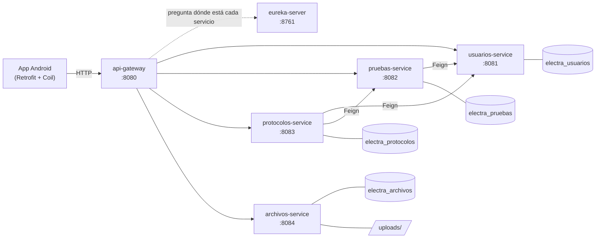

# Electra Backend

Microservicios de **Electra**, la app de Android para registrar pruebas eléctricas en terreno y los protocolos que las formalizan. La app ([repositorio Electra](https://github.com/Simon2853/Electra)) consume estos servicios con Retrofit a través del API Gateway.

**Tecnologías:** Kotlin · Spring Boot 4.1.3 · Spring Cloud 2025.1.4 (Eureka, Gateway, OpenFeign) · Spring Data JPA · MySQL 8 (Laragon) · springdoc-openapi (Swagger) · JUnit 5 + MockK · JaCoCo · Maven

---

## Arquitectura



**El recorrido de una petición:** la app llama a `https://<url-publica>/api/pruebas?usuario=...`. El **Gateway** revisa el prefijo de la ruta y le pregunta a **Eureka** dónde está `pruebas-service`. El servicio que recibe la petición le pregunta a `usuarios-service` (**Feign**) cuál es el rol del usuario, consulta **su propia base de datos** y responde con JSON.

| Servicio | Puerto | Responsabilidad | Base de datos |
|---|---|---|---|
| `eureka-server` | 8761 | Registro y descubrimiento de servicios | — |
| `api-gateway` | 8080 | Única entrada para la app; enruta según el prefijo | — |
| `usuarios-service` | 8081 | Cuentas, login, contraseñas (BCrypt), perfil y roles | `electra_usuarios` |
| `pruebas-service` | 8082 | Pruebas eléctricas e historial por equipo | `electra_pruebas` |
| `protocolos-service` | 8083 | Protocolos, número correlativo único, formalización | `electra_protocolos` |
| `archivos-service` | 8084 | Fotos de evidencia y de perfil | `electra_archivos` + carpeta `uploads/` |

### Decisiones técnicas

- **Una base de datos por servicio.** No hay tablas compartidas ni llaves foráneas entre servicios. Por eso `creadoPor` es texto (el login), y cuando un servicio necesita datos de un usuario se los pide a `usuarios-service` con Feign.
- **Los servicios se buscan por nombre, no por IP.** Gateway y Feign usan `lb://usuarios-service`, y Eureka les dice la dirección. Si un servicio cambia de puerto o se levantan dos copias, nada más cambia.
- **Los permisos los valida el servidor.** La app oculta los botones según el rol, pero el servidor también lo comprueba. Así, quien llame directo a la API no puede saltarse las reglas.
- **Errores uniformes.** Todos los servicios responden `{"estado", "mensaje", "campos"}` con el código HTTP correcto: 400 datos inválidos, 401 credenciales, 403 sin permiso, 404 no existe, 409 choca con el estado, 413/415 imagen inválida, 503 otro servicio caído.
- **Tolerancia a fallas.** Si `usuarios-service` está caído, los demás responden 503 con un mensaje claro en vez de caerse.

### Reglas de negocio por servicio

**usuarios-service**
- Las contraseñas se guardan cifradas con BCrypt, nunca en texto plano. Las respuestas no incluyen el hash.
- El login da el mismo error si el usuario no existe o si la contraseña es incorrecta, para no revelar qué cuentas existen.
- Para recuperar la contraseña se pide el usuario y el nombre registrado.

**pruebas-service**
- Visibilidad: el técnico ve solo sus pruebas. Supervisor y administrador ven las de todos, desde que se creó su cuenta.
- El supervisor no registra pruebas (separación de funciones).
- Una prueba no se edita, porque es evidencia. Solo pueden eliminarla quien la registró o un administrador.

**protocolos-service**
- El número `#000123` sale del id `AUTO_INCREMENT` de MySQL, así que dos técnicos que guardan al mismo tiempo nunca obtienen el mismo número.
- Crean protocolos el técnico y el administrador. Formalizan el supervisor y el administrador. Queda registrado quién formalizó y cuándo.
- Un protocolo formalizado no se edita, no cambia de estado y no se elimina (409).

**archivos-service**
- Solo acepta JPEG, PNG o WebP, de hasta 5 MB. El formato se detecta por los primeros bytes del archivo, no por la extensión.
- El id es un UUID aleatorio, para que no se puedan adivinar fotos ajenas.
- Devuelve una ruta relativa (`/api/archivos/{id}`) y la app le antepone su URL base. Así las fotos siguen cargando aunque cambie la URL pública.

---

## Requisitos

- **JDK 21 o superior.** Sirve el que trae Android Studio: `C:\Program Files\Android\Android Studio\jbr`.
- **MySQL 8 en el puerto 3306,** usuario `root` sin contraseña (lo que trae Laragon por defecto). Las bases de datos se crean solas al arrancar cada servicio.
- Maven **no** hace falta instalarlo: cada servicio trae `mvnw`.

## Cómo levantarlo

### Opción rápida: `iniciar-todo.cmd`

1. Abre **Laragon** y presiona **Start All**. Comprueba que MySQL esté corriendo.
2. Haz doble clic en **`iniciar-todo.cmd`**, en la raíz del repositorio. Abre cada microservicio en su propia ventana y en este orden:
   1. `eureka-server`, y espera a que responda;
   2. `usuarios`, `pruebas`, `protocolos` y `archivos`, y espera a que respondan;
   3. `api-gateway`.
3. Para detener un servicio, cierra su ventana.

El script usa el JDK de Android Studio si `JAVA_HOME` no está configurado. Si un servicio no arranca en 3 minutos, avisa cuál fue. Lo más común es que MySQL no esté corriendo.

**Por qué ese orden:** Eureka es el registro donde cada servicio se anuncia al arrancar ("soy pruebas-service y estoy en el puerto 8082"). El Gateway le pregunta a Eureka dónde está cada servicio para reenviarle las peticiones de la app. El orden no es obligatorio, porque los servicios reintentan registrarse y el Gateway vuelve a consultar Eureka cada 30 segundos. Pero así se evitan los errores 503 mientras todo se encuentra.

### Opción manual (un servicio por terminal)

1. Abre **Laragon** y presiona **Start All**. Comprueba que MySQL esté corriendo.
2. Indica qué JDK usar, en cada terminal que abras (PowerShell):
   ```powershell
   $env:JAVA_HOME = "C:\Program Files\Android\Android Studio\jbr"
   ```
3. Levanta los servicios **en este orden**, cada uno en su propia terminal:
   ```powershell
   cd eureka-server;      .\mvnw spring-boot:run   # primero: los demás se registran aquí
   cd usuarios-service;   .\mvnw spring-boot:run
   cd pruebas-service;    .\mvnw spring-boot:run
   cd protocolos-service; .\mvnw spring-boot:run
   cd archivos-service;   .\mvnw spring-boot:run
   cd api-gateway;        .\mvnw spring-boot:run
   ```
   En VS Code también se puede hacer con la extensión **Spring Boot Dashboard**.
4. Abre http://localhost:8761. Los 5 servicios deben aparecer en *Instances currently registered with Eureka*. Después de arrancar, el Gateway tarda unos 30 segundos en enterarse de los servicios nuevos: si responde 503, espera un poco y vuelve a intentar.
5. Prueba que todo funcione: http://localhost:8080/api/usuarios debería responder `[]` o la lista de cuentas.

## Exponer el Gateway a Internet (para la app)

El teléfono no puede llegar a `localhost` del computador, así que se publica **solo el puerto 8080** (el Gateway) con el reenvío de puertos de VS Code:

1. En VS Code, abre el panel **Puertos** (*Ports*, junto a la Terminal) y elige **Reenviar un puerto** → `8080`. Pide iniciar sesión con GitHub.
2. Haz clic derecho sobre el puerto → **Visibilidad del puerto** → **Pública**.
3. Copia la **dirección reenviada** (algo como `https://abc123-8080.brs.devtunnels.ms`) y pégala como `BASE_URL` de Retrofit en la app.
4. La URL **cambia cada vez que se crea el túnel de nuevo**. Por eso la app la tiene en un solo lugar y las fotos se guardan con ruta relativa.

> Si al abrir la URL en el navegador aparece una página de advertencia de *Dev Tunnels*, es normal: Retrofit no la ve. Si llegara a aparecer en la app, se evita enviando el encabezado `X-Tunnel-Skip-AntiPhishing-Page: true`.

---

## Endpoints

La documentación completa, con ejemplos y la opción de probar cada endpoint, está en el **Swagger** de cada servicio:

| Servicio | Swagger UI |
|---|---|
| usuarios | http://localhost:8081/swagger-ui.html |
| pruebas | http://localhost:8082/swagger-ui.html |
| protocolos | http://localhost:8083/swagger-ui.html |
| archivos | http://localhost:8084/swagger-ui.html |

Todas las rutas se llaman a través del Gateway (`:8080`):

| Método | Ruta | Descripción |
|---|---|---|
| POST | `/api/auth/registro` | Crear una cuenta (rol `tecnico` por defecto) |
| POST | `/api/auth/login` | Iniciar sesión; devuelve los datos y el rol |
| POST | `/api/auth/restablecer` | Recuperar la contraseña con usuario y nombre |
| GET | `/api/usuarios` | Listar las cuentas |
| GET | `/api/usuarios/{usuario}` | Obtener una cuenta |
| PUT | `/api/usuarios/{usuario}/nombre` · `/contrasena` · `/avatar` · `/rol` | Editar el perfil |
| POST | `/api/pruebas` | Registrar una prueba |
| GET | `/api/pruebas?usuario=&equipo=` | Pruebas visibles para el usuario; con `equipo`, el historial |
| GET | `/api/pruebas/equipos?usuario=` | Equipos con pruebas |
| GET · DELETE | `/api/pruebas/{id}?usuario=` | Obtener o eliminar una prueba |
| POST | `/api/protocolos` | Crear un protocolo (el número lo asigna el servidor) |
| GET | `/api/protocolos?usuario=` | Protocolos visibles para el usuario |
| GET | `/api/protocolos/siguiente-numero` | Próximo número (referencial) |
| GET · DELETE | `/api/protocolos/{numero}?usuario=` | Obtener o eliminar (`{numero}`: `123`, `000123` o `%23000123`) |
| GET | `/api/protocolos/{numero}/pruebas?usuario=` | Pruebas del equipo del protocolo (vía Feign a pruebas) |
| PUT | `/api/protocolos/{numero}/estado` · `/observaciones` | Formalizar o editar las observaciones |
| POST | `/api/archivos` | Subir una imagen (multipart: `archivo`, `categoria`, `subidoPor`) |
| GET | `/api/archivos/{id}` | Descargar la imagen (la usa Coil) |
| GET | `/api/archivos/{id}/info` · `/api/archivos?subidoPor=` | Datos de una imagen o de todas las de un usuario |
| DELETE | `/api/archivos/{id}?usuario=` | Eliminar una imagen propia |

---

## Pruebas unitarias y cobertura

Cada servicio de negocio tiene pruebas de **modelo**, **servicio** (con repositorio y Feign simulados con MockK) y **controlador** (MockMvc, sin servidor ni base de datos). No necesitan MySQL ni otros servicios corriendo.

```powershell
cd usuarios-service
.\mvnw verify      # ejecuta las pruebas, genera el informe y falla si la cobertura baja del 80 %
```

El informe de JaCoCo queda en `target/site/jacoco/index.html`.

| Servicio | Pruebas | Cobertura de líneas |
|---|---|---|
| usuarios-service | 29 | 94,6 % |
| pruebas-service | 28 | 95,1 % |
| protocolos-service | 30 | 95,1 % |
| archivos-service | 23 | 93,6 % |

En la cobertura se excluyen solo las clases `*Application` (el `main` que arranca Spring), porque no tienen lógica.

## Estructura de cada servicio

```
src/main/kotlin/com/electra/<servicio>/
├── controller/   endpoints REST (traducen HTTP ↔ servicio)
├── service/      reglas de negocio
├── repository/   acceso a MySQL con Spring Data JPA
├── model/        entidades (tablas) y reglas del dominio
├── dto/          lo que entra y sale en JSON, con validaciones
├── client/       clientes Feign hacia otros servicios (pruebas y protocolos)
├── exception/    errores de negocio y su traducción a códigos HTTP
└── config/       Swagger y otros beans
```
